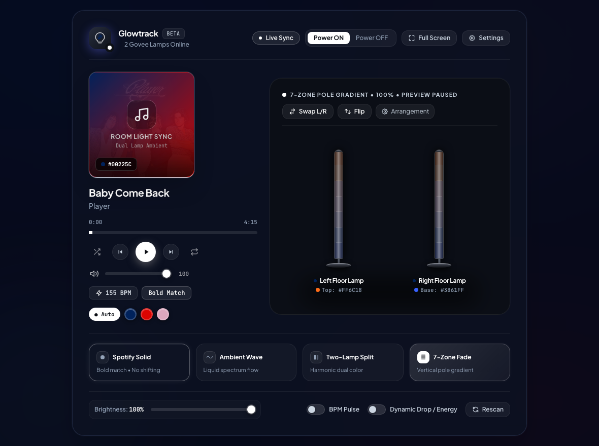

# Glowtrack

Your smart lights follow the album art of whatever is playing on your Mac: Spotify, Apple Music,
YouTube Music, Tidal, Amazon Music, Deezer, a browser tab, anything that shows up in macOS
Now Playing. Built for **Govee floor lamps**, with experimental support for **WiZ, LIFX and WLED** lights.
Everything stays on your Wi-Fi, there is no account, and it works with a free Spotify account.

### [Download for Mac](https://github.com/omerham/glowtrack/releases/latest)

Pick the look you want. They are all the same app, and you can switch any time in Settings, Design.

| Download | Design |
|---|---|
| [Glowtrack-a.zip](https://github.com/omerham/glowtrack/releases/latest/download/Glowtrack-a.zip) | **A, Instrument**: a hardware panel with keys, a knob and LED bars |
| [Glowtrack-b.zip](https://github.com/omerham/glowtrack/releases/latest/download/Glowtrack-b.zip) | **B, Dot**: dot-matrix type, the lamps drawn in dots |
| [Glowtrack-c.zip](https://github.com/omerham/glowtrack/releases/latest/download/Glowtrack-c.zip) | **C, Poster**: flat colour blocks and huge condensed type |
| [Glowtrack-d.zip](https://github.com/omerham/glowtrack/releases/latest/download/Glowtrack-d.zip) | **D, Stage**: the framed cover over a living, drifting background |
| [Glowtrack-classic.zip](https://github.com/omerham/glowtrack/releases/latest/download/Glowtrack-classic.zip) | **Classic**: the original dashboard |



> Unofficial hobby project. Not affiliated with or endorsed by Govee or Spotify.

## Get started (about two minutes)

1. **Turn on LAN Control** for each lamp: Govee Home app, the lamp, Settings, LAN Control.
   (Without this the lamps cannot hear the Mac.)
2. **Download** a zip above and unzip it. Drag **Glowtrack** into your Applications folder.
3. **Open it the first time with right-click, then Open.** The app is not notarised by Apple,
   so a double-click shows "can't be opened". Right-click, Open, Open is a one-time step.
   (If you only see "Move to Bin", go to System Settings, Privacy & Security and choose *Open Anyway*.)
4. If macOS offers to install the **command-line developer tools**, say yes: it provides the Python
   that runs the lighting server. Allow the permission prompts for controlling Spotify and for the local network.
5. Play a song. The lamps are found automatically, and Glowtrack lives in your menu bar.
   To change the design, open the dashboard from the menu bar and go to Settings, Design.

**Needs:** an Apple silicon Mac (M1 or later) with macOS 13 or later, and one or two Govee H6076
floor lamps on the same Wi-Fi as the Mac. Other Govee lamps with LAN control may work but are untested.

Something not working, or it worked great? Use **Report a problem** in Settings or the menu bar.

## Build from source

For developers. (The build script targets Apple silicon; change `-target` in `mac/build.sh` to build for Intel, untested.) You need Xcode command-line tools (`xcode-select --install`) and Pillow
(`/usr/bin/python3 -m pip install --user Pillow`).

```
git clone https://github.com/omerham/glowtrack.git ~/GoveeSpotifySync
cd ~/GoveeSpotifySync
mac/build.sh
cp -R build/Glowtrack.app /Applications/
```

The built app expects the server at `~/GoveeSpotifySync/server/app.py`; to keep the
code elsewhere, change `GoveeServerPath` in `mac/Info.plist` before building.
You can also run just the server: `/usr/bin/python3 server/app.py`.
`mac/build.sh --dist` builds the self-contained downloads (one per design) in `build/dist`.

## Using it

- **Glowtrack** (in Applications) lives in the menu bar.
  From there: open the dashboard, switch mode, brightness, play/pause, next track,
  *Open at Login*, restart the lighting server, quit.
- Dashboard: <http://127.0.0.1:8765> on this Mac. Phones/iPads on the same Wi-Fi can use it too
  after a one-time pairing (see *Privacy and security*). Set `GOVEE_LOCAL_ONLY=1` to allow this Mac only.
  To use another port, change `GoveeServerPort` in `mac/Info.plist` (or `GOVEE_PORT` when running the server by hand).
- Logs: `~/Library/Logs/GoveeSpotifySync.log`. Settings: `~/.govee_spotify_config.json`.

### Modes
| Mode | Motion |
|---|---|
| Solid | still – one album colour on both lamps |
| Colour Fade | moving – both lamps flow through the album colours together |
| Two-Lamp Split | still – a different album colour on each lamp |
| 7-Zone Fade | moving – album colours flow up the 7 zones of each lamp |

Fine-tuning (colour cycle speed, song fade, vibrancy, pulse depth, tempo, dark
colour boost, lamp preview quality) is in the dashboard's Settings.

## Privacy and security

- Lamp control and the dashboard stay on your network. There is no account and no analytics.
- To find tempo and lyrics, the current song and artist names are sent to Deezer,
  songbpm.com and lrclib.net. Album art is fetched from Spotify's own image servers.
- **Pairing:** this Mac can always use the dashboard. Phones and tablets on your Wi-Fi must be
  paired once: open **Settings → Phone & tablet access** on the Mac and open that link on the
  device. Anyone with the link can control your lamps and Spotify, so keep it private. To pair
  nothing and keep it Mac-only, set `GOVEE_LOCAL_ONLY=1`; to skip pairing and let anyone on
  the network in (not recommended), set `GOVEE_OPEN_LAN=1`.
  Debug commands (`/api/debug_record`, `/api/lamp_test`) always require a request from this Mac.

## Contributing and license

See [CONTRIBUTING.md](CONTRIBUTING.md). MIT licensed, see [LICENSE](LICENSE).

## Project layout

```
server/            Python lighting server (no installs needed beyond Pillow)
  app.py           entry point; restarts itself when any .py file changes
  config.py        settings, constants, saved config
  colors.py        album-art palette extraction, LED calibration, blending
  spotify.py       reads/controls the Spotify app via AppleScript
  players.py       picks Spotify or macOS Now Playing; routes the playback buttons
  nowplaying/      mr.m: small helper that reads/controls macOS Now Playing
  tempo.py         song tempo lookup (Deezer, songbpm.com)
  lamps.py         Govee LAN protocol (discovery, status, UDP packets)
  devices.py       other lights: WiZ, LIFX, WLED (experimental)
  engine.py        app state + lighting engine (the only code that talks to lamps)
  web.py           dashboard web server
  web/             dashboard: index.html, app.js, app.css, tailwind.css (pre-built)
mac/               menu-bar app (Swift): main.swift, Info.plist, build.sh
tools/             build_tailwind.py – rebuilds web/tailwind.css
tests/             engine tests (no lamps or Spotify needed)
archive/           old versions, kept for reference (not used)
```

## Developing

- Edit anything in `server/` – the server reloads itself (only if the code compiles).
  Dashboard files in `server/web/` are read fresh on every page load.
- Added new Tailwind classes to the page? Rebuild the styles:
  `/usr/bin/python3 tools/build_tailwind.py`, then open <http://127.0.0.1:8798>.
- Tests: `/usr/bin/python3 -m unittest discover tests`
- Rebuild the menu-bar app: `mac/build.sh`, then copy `build/Glowtrack.app`
  to Applications.

## Other lights (experimental)

Besides your Govee lamps, Glowtrack can drive **WiZ**, **LIFX** and **WLED** lights over your local
network. Open **Settings → Other lights**, press *Scan* (WiZ and LIFX are found automatically;
for a WLED strip type its IP address), and choose whether each light follows the left or right lamp.
Single-colour lights show the average of that lamp's colours; a WLED strip spreads the lamp's 7 zones
along its length (turn on WLED's realtime/UDP listening, which is the default).

These drivers (`server/devices.py`) were written from the products' published protocols and are
checked against fake devices in the tests, but **have not been tried on real hardware yet**. If you
try one, please report whether it worked. Other Govee models that report their model name are
driven with a single colour, since only the H6076's zone packets are known.

## Designs

Settings → **Design** switches the whole look: the main screen, Settings and Full Screen (with
synced lyrics) all change together. **Classic** is the original; the four new ones are:

- **A Instrument**: a hardware panel with keys, a knob, LED bars and a tick ruler.
- **B Dot**: dot-matrix type, with the lamps drawn in dots.
- **C Poster**: flat colour blocks and huge condensed type.
- **D Stage**: the framed cover on a wall washed with the lamps' colours.

Each works on a computer, tablet and phone (held upright the layout changes). They are light on the
CPU: the page is built once per screen, only the lamp colours change on a timer (about 8 times a
second while the lamps move, slower on "Low power", not at all when the lamp preview is off, the
window is hidden or the lamps are still), and the clock and lyrics tick once a second.
In Full Screen the controls fade away after a few seconds and the song (or lyrics) stays.

## Which players work

- **Spotify** is read directly (cover link, volume, shuffle, repeat all work).
- **Everything else** (Apple Music, browsers, Tidal, Amazon Music, Deezer, ...) is read from
  macOS's own *Now Playing* info, the same thing Control Centre shows. If the song appears
  there, Glowtrack can light to it. The helper (`server/nowplaying/mr.m`) is built into
  `~/Library/Caches/Glowtrack` on first run.
- If Spotify is playing it wins; otherwise whatever Now Playing reports. Play/pause, next,
  previous and seeking go to the player in use. Shuffle/repeat only work for Spotify, and
  the volume slider changes the Mac's output volume for other players.
- Needs the song to have artwork in Now Playing for album colours; otherwise the lamps keep the
  current colours. Lyrics need a title and artist.
- Now Playing is a private macOS interface (reached through Apple's own `perl`), so a future macOS
  update could break non-Spotify support.

## How song changes are detected

Spotify and Apple Music announce every song change and play/pause to the system. The menu-bar
app forwards that announcement to the server (`/api/spotify_changed`), which reads
the new song straight away. A slow background poll (every 4 s, or 1.8 s if the
announcements aren't arriving) is kept as a safety net, and is the only way other players are noticed (1.8 s).
